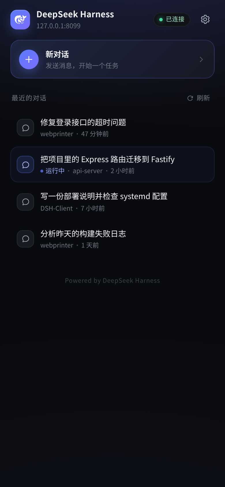
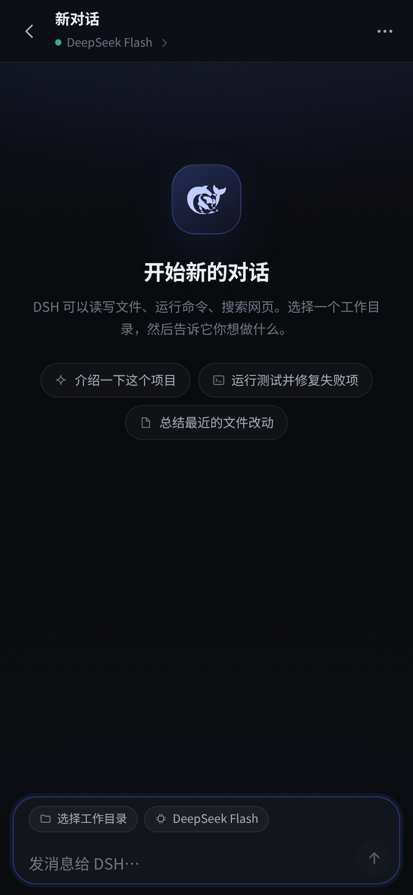
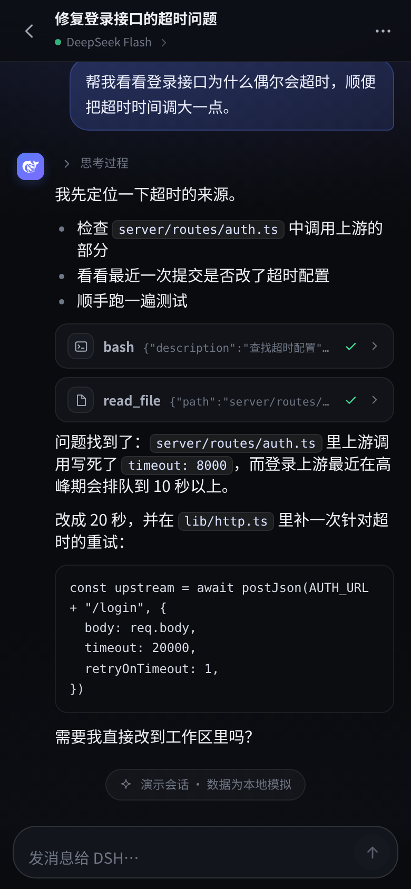
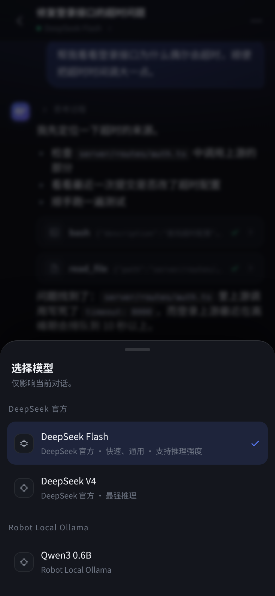
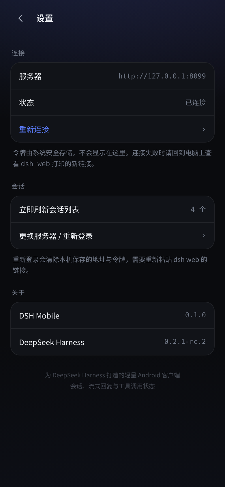

# DSH Mobile — DeepSeek Harness 安卓客户端


> 仓库：<https://github.com/Epivitae/DeepSeek-Harness-Android> ·
> 安装包见 [Releases](https://github.com/Epivitae/DeepSeek-Harness-Android/releases)。

一个为 [DeepSeek Harness](https://github.com/deepseek-ai/deepseek-harness)（`dsh web`）打造的轻量
Android 客户端。自绘的移动端界面，直接使用 DSH 官方的 HTTP / WebSocket 协议，不修改服务器、
不安装插件，安装 APK 后填入 `dsh web` 打印的链接即可在手机上使用。

> 目标设备：荣耀 / 华为等 Android 手机（MagicOS / EMUI 均可，Android 7.0+）。
> 已在 **荣耀 50（NTH-AN00，Android 14 / MagicOS，1080×2340）** 上完成实机验证：
> 原生登录 → 会话列表 → 历史记录 → 发送消息 → 流式回复 → 模型切换 → 重启自动登录。

| 会话列表 | 新对话 | 对话 |
| :---: | :---: | :---: |
|  |  |  |

| 选择模型 | 设置 |
| :---: | :---: |
|  |  |

> 截图使用演示数据，仅用于展示界面。

---

## 一、有没有现成的官方安卓客户端？

**结论：DeepSeek Harness 官方目前没有 Android 客户端。**

调研（2026-10）依据：

- 官方仓库 [deepseek-ai/deepseek-harness](https://github.com/deepseek-ai/deepseek-harness) 的 README、
  Release 资源（`dsh-v0.2.1-rc.2` / `rc.3` 的资产为空）、Issue 搜索均无 Android / iOS / 移动客户端。
- npm `@deepseek-ai` 组织下没有移动客户端包，只有 Web 前端、ACP、SDK 等。
- Web 端只是一个网页，没有 Service Worker，不满足可安装 PWA 的条件，且是桌面三栏布局。

社区里有若干**非官方**项目，可按需选择：

| 项目 | 说明 |
| --- | --- |
| [Hakunm/dsh-android-app](https://github.com/Hakunm/dsh-android-app) | Kotlin/Compose 原生远程客户端，AGPL-3.0 |
| [Soodok/Deepseek-Harness-Local-Android](https://github.com/Soodok/Deepseek-Harness-Local-Android) | 在手机内直接跑完整 DSH 引擎（本地模式），MIT |
| [eyru/dsh-mobile-android](https://github.com/eyru/dsh-mobile-android) | 极简客户端 + Tailscale 隧道 |
| 其他 | `xliaoy/DeepSeekHarness`、`itiswdwa/dsh-android` 等 |

本项目与其定位不同：**远程协议客户端**。它不内置 Node / DSH 引擎，而是连接你电脑上正在运行的
`dsh web`，共享同一批会话、同一个工作目录和同一套模型配置；界面为手机重新设计，安装即用。

---

## 二、功能

- **连接**：粘贴 `dsh web` 完整链接或手动填写服务器地址 + Token；Token 保存在本机，重启后自动登录。
- **会话列表**：读取 `/root` 下所有 DSH 会话，显示标题、工作目录、最后活动时间、运行中状态；7 秒自动刷新。
- **对话**：读取会话历史（含工具调用与思考过程），自动滚动、上拉加载更早消息、回到最新。
- **流式回复**：实时显示模型输出；思考过程可折叠；工具调用显示名称/状态，点开可看参数和结果。
- **发送 / 停止**：支持排队发送（运行中继续发）与中止当前生成。
- **新对话**：选择工作目录（记住最近使用的目录），首条消息发出时才创建会话，不产生空会话。
- **模型选择**：按会话切换模型与推理强度（读取服务器 `session/modelCatalog`）。
- **重命名**、**断线自动重连**（指数退避，重连后自动恢复订阅）、**令牌失效提示**。
- **任务通知**：长任务运行期间离开对话页或切到后台，任务结束时通过 Android 通知栏提醒（点击回到 App）。
- **界面**：深色、低对比度、大圆角、系统字体；手机竖屏单栏，横屏 / 平板自动双栏；支持安全区、刘海与输入法。
- **零第三方 SDK / 零广告 / 零埋点**，只申请网络权限。

---

## 三、快速开始

### 1. 服务器端

在电脑上正常启动 `dsh web`（或确认系统服务在运行）：

```bash
dsh web --host 0.0.0.0 --port 3080
# 如果作为系统服务运行，也可以从日志里找到启动时打印的链接
# （token 每次重启都会变化）：
journalctl -u dsh-web --no-pager | grep 'dsh web:' | tail -1
```

会得到类似：

```
dsh web: https://<machine>.<tailnet>.ts.net:3080/?token=XXXXXXXX
```

### 2. 安装 APK

- 文件：`dist/DSH-Client-1.1.1.apk`（`dist/dsh-client-debug.apk` 为调试版）
- 传到荣耀手机（数据线、网盘、微信文件传输均可），在「设置 → 安全 → 安装未知应用」中允许安装。
- 或使用 adb：`adb install -r dist/DSH-Client-1.1.1.apk`
- 无线调试（Android 11+）：开发者选项里打开「无线调试」，`adb pair <手机IP>:<配对端口> <配对码>`
  后 `adb connect <手机IP>:<调试端口>` 即可安装（该流程已在荣耀 50 上验证）。

> 如果服务器重启导致 Token 变化，在 App 内「设置 → 更换服务器 / 重新登录」重新粘贴新链接。

> APK 纯 Java + 系统 WebView，无 native 库，arm64 / x86 通用；要求 Android 7.0+。

### 3. 第一次连接

1. 打开 App，把上面完整的 `…/?token=…` 链接粘贴到「服务器地址」输入框（Token 会自动解析），点「连接」。
2. 也可以分开填：地址填 `http://192.168.1.10:3080`，Token 填链接里 `token=` 后面的字符串。
3. 连接成功后进入会话列表。首次启动会请求**通知权限**（Android 13+），用于「任务完成」提醒；允许后长任务结束时手机会收到通知。

**两种网络方式：**

- **局域网**（推荐在家 / 办公室）：手机和电脑在同一个 Wi-Fi，地址用
  `http://<电脑局域网 IP>:3080/?token=…`（如 `http://192.168.1.10:3080`）。
- **Tailscale**（外网可用）：手机安装 Tailscale 并登录同一个 tailnet，使用
  `https://<机器名>.<tailnet>.ts.net:3080/?token=…`，走 HTTPS，安全且不需要公网 IP。

> 服务器重启后 Token 会变，App 会提示连接失效，点「更换服务器 / 重新登录」，粘贴新链接即可。

---

## 四、目录结构

```
DSH-Client/
├── app/                     Android 工程（纯 Java，无 Gradle / AndroidX）
│   ├── src/ai/deepseek/dshclient/
│   │   ├── MainActivity.java     WebView 壳：原生登录、Cookie、加载内置 UI、返回键 / 安全区
│   │   └── ServerAuth.java       Token → Cookie 认证与 /api 校验
│   ├── assets/ui/index.html      构建时内联的界面（由 web/ 生成）
│   └── AndroidManifest.xml
├── web/                     手机界面源码（原生 JS / CSS，无框架）
│   ├── index.html / style.css / app.js    页面、设计系统、交互
│   ├── markdown.js          流式 markdown 渲染（转义安全）
│   ├── api.js               DSH 协议客户端（HTTP + /api/remote.mux WebSocket、重连）
│   └── transcript.js        会话快照 / 事件 / 流式增量 → 时间线
├── tools/
│   ├── build-apk.sh         aapt2 + javac + d8 + zipalign + apksigner 一键出包
│   ├── bundle-ui.mjs        把 web/ 的 CSS/JS 内联进 assets
│   ├── dev-proxy.mjs        本地开发代理（把 web/ 跑在真实 DSH 服务上）
│   ├── test-transcript.mjs  离线单测（需先用 test-capture.mjs 录制本地帧）
│   └── test-live.mjs        实机联调（列表 / 订阅 / 断线重连）
├── docs/
│   ├── PROTOCOL-NOTES.md    DSH Web 协议说明（本项目实测）
│   ├── protocol-tests.md    已验证端点、语义与测试命令
│   ├── BUILD.md             构建、签名、装机说明
│   └── screenshots/
└── dist/                    产物 APK
```

---

## 五、工作原理

1. **原生壳**（`MainActivity`）：用 `HttpURLConnection` 请求 `/?token=…`（禁止跟随跳转），拿到
   `Set-Cookie: dsh-auth-…`（HttpOnly），再调用一次 `POST /api/session/list` 校验，写入
   `CookieManager`。
2. **同源加载**：`WebView.loadDataWithBaseURL(serverOrigin, 内置HTML, …)` 让页面 origin 等于 DSH
   服务器 origin，页面的 `fetch('/api/...')` 和 `WebSocket('/api/remote.mux')` 自动携带 Cookie，
   不需要 CORS 或 `file://` 放宽。
3. **协议客户端**（`web/api.js`）：一元调用走 `POST /api/<endpoint>`，流式走单条多路复用
   WebSocket `/api/remote.mux`（`session/follow` 发送快照 + 增量事件 + assistant 流式帧），
   断线指数退避重连并自动重新订阅。协议细节见 [docs/PROTOCOL-NOTES.md](docs/PROTOCOL-NOTES.md)。
4. **时间线**（`web/transcript.js`）：把快照、持久事件、流式 chunk 归并为可渲染的
   `user / assistant / tool / notice` 条目；工具调用与结果按 `callId` 合并；流式提交后原位替换，
   不产生重复气泡。
5. **界面**（`web/app.js` + `style.css`）：纯原生 JS 的轻量渲染，无框架；markdown 渲染器自己实现
   并做 HTML 转义；界面中的文件会在构建时全部内联，离线可用（但数据仍来自服务器）。

---

## 六、开发与构建

```bash
# 1. 本地预览（页面 + 真实 DSH 代理，cookie 由代理注入）
node tools/dev-proxy.mjs            # http://127.0.0.1:8099/index.html
node tools/shot.mjs                 # 390×844 / 960×540 截图

# 2. 测试
node tools/test-transcript.mjs      # 离线，114 条断言
node tools/test-live.mjs            # 需要 dev-proxy，会创建/订阅测试会话

# 3. 构建 APK（需要 Debian Android SDK platform 31 / build-tools 31，JDK 17）
bash tools/build-apk.sh             # -> dist/dsh-client-debug.apk
bash tools/build-apk.sh --release   # -> dist/DSH-Client-1.1.1.apk（签名见 docs/BUILD.md）
```

开发只改 `web/` 与 `app/`，不要改 `app/assets/ui/`（构建产物）。详细工具链、签名和装机步骤见
[docs/BUILD.md](docs/BUILD.md)。

---

## 七、安全与隐私

- Token 只保存于本机 `SharedPreferences`，只用于换取 HttpOnly Cookie；界面内不可见。
- 连接优先使用 Tailscale HTTPS；局域网 HTTP 明文仅为方便内网使用（Android 清单中开启了
  `usesCleartextTraffic`，如只走 HTTPS 可关掉）。
- App 不采集、不上传任何数据；没有统计 SDK、没有广告、没有多余权限。
- 会话内容与文件操作都在你的 DSH 服务器上执行，手机只是远程界面。

---

## 八、已知限制 / 后续可做

- 图片、文件上传与附件预览尚未实现（v1 聚焦文字对话与工具过程）。
- `ask_user_question` 等需要人机交互的工具提问目前不会弹窗（默认 `danger-full-access`
  策略下无审批弹窗，但提问会等待输入）；后续版本会补上问题卡片。
- 子 Agent（subagent）/ Agent Team、计划模式等 UI 未单独展示，但会以工具调用的形式出现在对话里。
- 历史消息首屏加载 40 条，向上滚动时按需加载更早内容。
- 任务完成通知依赖系统对 WebView 后台运行的宽容度：App 被系统回收或用户强行停止后不会通知；长任务建议保留在最近任务中。该功能不使用任何推送服务/账号。
- 不支持在手机本地运行 DSH 引擎（需要电脑上常驻 `dsh web`；本地运行可参考上面的社区项目）。
- 需要 Android 7.0+ 且系统 WebView 可用（荣耀 / 华为自带 WebView 已实测）。

---

## 九、致谢与许可

- 协议与产品来自 [DeepSeek Harness](https://github.com/deepseek-ai/deepseek-harness)（MIT）。
- 界面中的鲸鱼标志取自 DeepSeek Harness 前端资源（MIT）。
- 本项目代码以 MIT 许可发布，详见 [LICENSE](LICENSE)。
